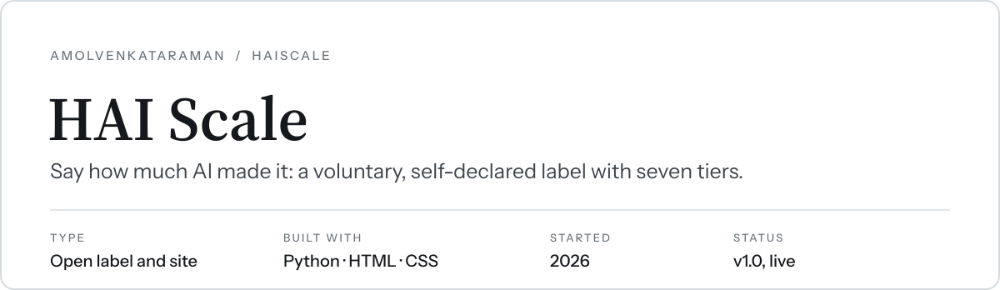
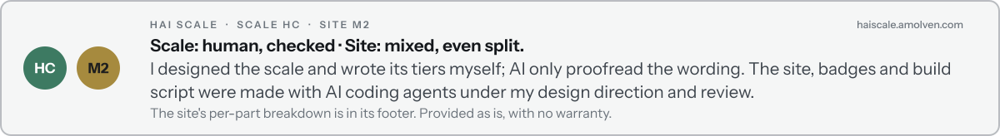

<!-- header:start -->
<div align="center">



[](https://haiscale.amolven.com)
[](LICENSE.md)

[The tiers](#the-tiers) · [Use it](#use-it) · [For AI agents](#for-ai-agents) · [How it's built](#how-its-built) · [Build and deploy](#build-and-deploy) · [Licence](#licence)

</div>

<a href="https://haiscale.amolven.com/"></a>
<!-- header:end -->

A voluntary, self-declared label for saying how much AI went into something you made: writing, images,
video, code. Seven tiers from fully human to fully automated, shown as one badge where people start
reading. The site at [haiscale.amolven.com](https://haiscale.amolven.com) explains each tier and hands you
the right badge for wherever it's going.

It is not a certification, an audit or a legal standard. Nobody checks a badge; it's the maker's own word,
like a byline.

## The tiers

| Code | Name | Meaning |
|------|------|---------|
| `H` | Fully human | No AI at any stage. Deterministic tools only. |
| `HC` | Human, checked | Made by a person. AI only checked it or made minor fixes that don't change the content. |
| `M1` | Mixed, human-leaning | Mostly human-made. AI contributed some content late in the process. |
| `M2` | Mixed, even split | Roughly half human, half AI, throughout. |
| `A1` | Mostly automated | Mostly AI output. A person prompted, steered, tested and verified. |
| `A2` | Almost fully automated | Almost entirely AI. A person prompted it and did a final check. |
| `AF` | Fully automated | 100% AI-generated. No human reviewed it before release. |

Each tier has its own page, like [haiscale.amolven.com/A1](https://haiscale.amolven.com/A1/), which is
where badges link to.

## Use it

The [badge generator](https://haiscale.amolven.com/#generator) asks a few questions to find your tier,
then gives you the snippet or file for where the badge is going: a website, a README, a document, slides,
video, an image, a social post, email, source code, print or a small icon.

In a README:

```markdown
[](https://haiscale.amolven.com/A1/)
```

On a web page, plus a machine-readable tag in `<head>`:

```html
<a href="https://haiscale.amolven.com/A1/"></a>
<meta name="hai-scale" content="A1">
```

| Badge | For | Files |
|-------|-----|-------|
| Chip | The default: bylines, READMEs, footers, documents | `badge/<CODE>.svg`, `-dark.svg`, PNG @2x/@4x, PDF |
| Circle | Corners and icons where a chip's text won't fit | `badge/circle/<CODE>.svg`, PNG 64–512, PDF |
| Dot | The circle without text, under 24 px | `badge/dot/<CODE>.svg` |

Everything is also in [one zip](https://haiscale.amolven.com/hai-scale-kit.zip), and the scale is
published as [hai.json](https://haiscale.amolven.com/hai.json).

## For AI agents

[`agents.md`](https://haiscale.amolven.com/agents.md) is a single Markdown file that tells a coding or
writing agent how to pick a tier and insert the badge. Paste this into an agent:

```
Read https://haiscale.amolven.com/agents.md and add the right HAI Scale badge to this project. Tell me which tier you chose and why.
```

Using AI to choose or add the badge doesn't count as AI use: the tier describes how the content was made,
not how the label got there.

## How it's built

A Python script turns one data file into the whole site and every badge format. Badge and logo text is
converted to outlines, so the files look the same without the fonts installed.

| Path | What |
|------|------|
| `src/tiers.json` | The scale: codes, names, colours, wording, version and base URL. The single source of truth |
| `src/disclosure.json` | The site's own "How this was made" breakdown |
| `src/index.template.html`, `src/tier.template.html`, `src/license.template.html` | Page templates, including the generator |
| `src/style.css`, `src/fonts/` | Styles; Instrument Sans and Source Serif 4 (OFL) |
| `src/examples/` | Example files linked from the site |
| `src/_headers` | UTF-8 content types and CORS for the deployed files |
| `build.py` | Builds `site/`: pages, badges (SVG, PNG, PDF), logo, favicon, social image, `agents.md`, `hai.json`, the zip |
| `serve.py` | Local preview of `site/` with UTF-8 declared on text files |
| `wrangler.toml` | Cloudflare Workers static-assets config for `haiscale.amolven.com` |

## Build and deploy

Requires Python 3 with `fonttools`, `brotli` and `Pillow`, and Inkscape (for PNG and PDF export).

```bash
python3 build.py          # writes site/
python3 serve.py          # preview at http://localhost:8000
npx wrangler deploy       # publish site/ to haiscale.amolven.com
```

To release a new version of the scale, change `"version"` in `src/tiers.json` and rebuild.

The generator accepts deep links, for example `/?tier=A1&place=video&theme=dark`.

## Licence

The scale (the tiers, codes, names, meanings and colours, the badges, the name and the logo) is free to
use under the [HAI Scale License 1.0](LICENSE.md), including for commercial work, on three conditions:
use it truthfully, keep the scale intact, and don't sell access to the scale itself.

The fonts are under the SIL Open Font License (`src/fonts/OFL-*.txt`).
